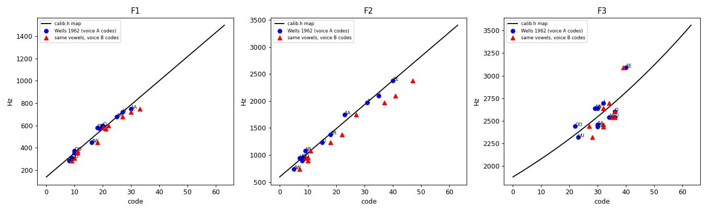
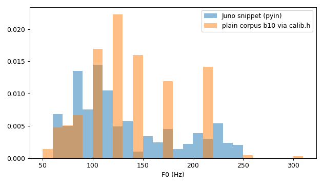
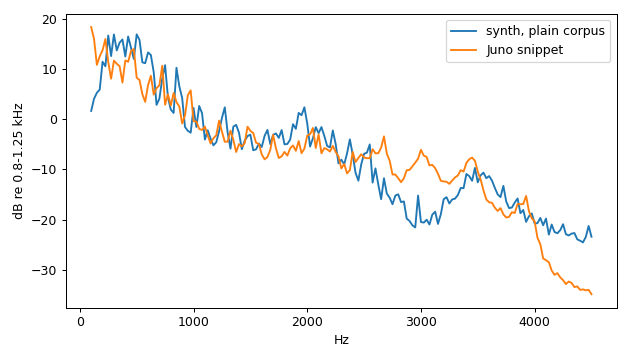

# Synthesizer calibration report

Generated by `tools/calibrate.py report` from the current `src/synth/calib.h`. Reference:
Wells (1962) RP male means (`tools/data/`). Juno: `dolphin_juno_demo.mp3` 5-25 s.

## Vowel formants (F1/F2/F3)

| Vowel | Keyword | Codes A | Codes B | Wells Hz | calib.h Hz (A) | Error % |
|---|---|---|---|---|---|---|
| EE | heed | 8/40/40 | 9/47/39 | 285/2373/3088 | 312/2377/2818 | +9/+0/-9 |
| I | hid | 10/35/32 | 11/41/34 | 356/2098/2696 | 355/2154/2598 | -0/+3/-4 |
| E | head | 19/31/30 | 21/37/32 | 569/1965/2636 | 549/1975/2546 | -4/+1/-3 |
| AA | had | 30/23/30 | 33/27/32 | 748/1746/2460 | 786/1619/2546 | +5/-7/+4 |
| AR | hard | 25/9/34 | 27/11/35 | 677/1083/2540 | 678/995/2652 | +0/-8/+4 |
| O | hod | 20/8/36 | 22/10/36 | 599/891/2605 | 570/950/2706 | -5/+7/+4 |
| AW | haw'd | 16/5/29 | 18/7/32 | 449/737/2635 | 484/816/2520 | +8/+11/-4 |
| OO | hood | 10/8/22 | 11/10/27 | 376/950/2440 | 355/950/2347 | -6/-0/-4 |
| UU | who'd | 9/7/23 | 10/9/28 | 309/939/2320 | 333/905/2371 | +8/-4/+2 |
| U | Hud | 27/15/36 | 30/18/36 | 722/1236/2537 | 721/1262/2706 | -0/+2/+7 |
| ER | heard | 18/18/30 | 20/22/32 | 581/1381/2436 | 527/1396/2546 | -9/+1/+5 |

Maps: F1 linear, F2 linear, F3 log. FN is hypothesis H-FN (0 + 8.0·code Hz).

## Amplitudes

0.949 dB per code; channel offsets (dB): ALF -5.1, A1 +0.0, A2 -12.8, A3 -26.7, AHF -33.8.

## F0

5th/50th/95th percentile: Juno 64 / 111 / 227 Hz; plain corpus through calib.h 61 / 124 / 213 Hz.

## Long-term average spectrum

Suggested channel corrections (apply with `calibrate.py fit --ltas`): ALF -0.3 dB, AHF +0.2 dB.

## Listening files (spec R4)

Rendered to `build/listening/` (not committed): every corpus text, plus `prose_voice_b`, `prose_hyp_b11` and `prose_hyp_b13` for the hypothesis switches.
